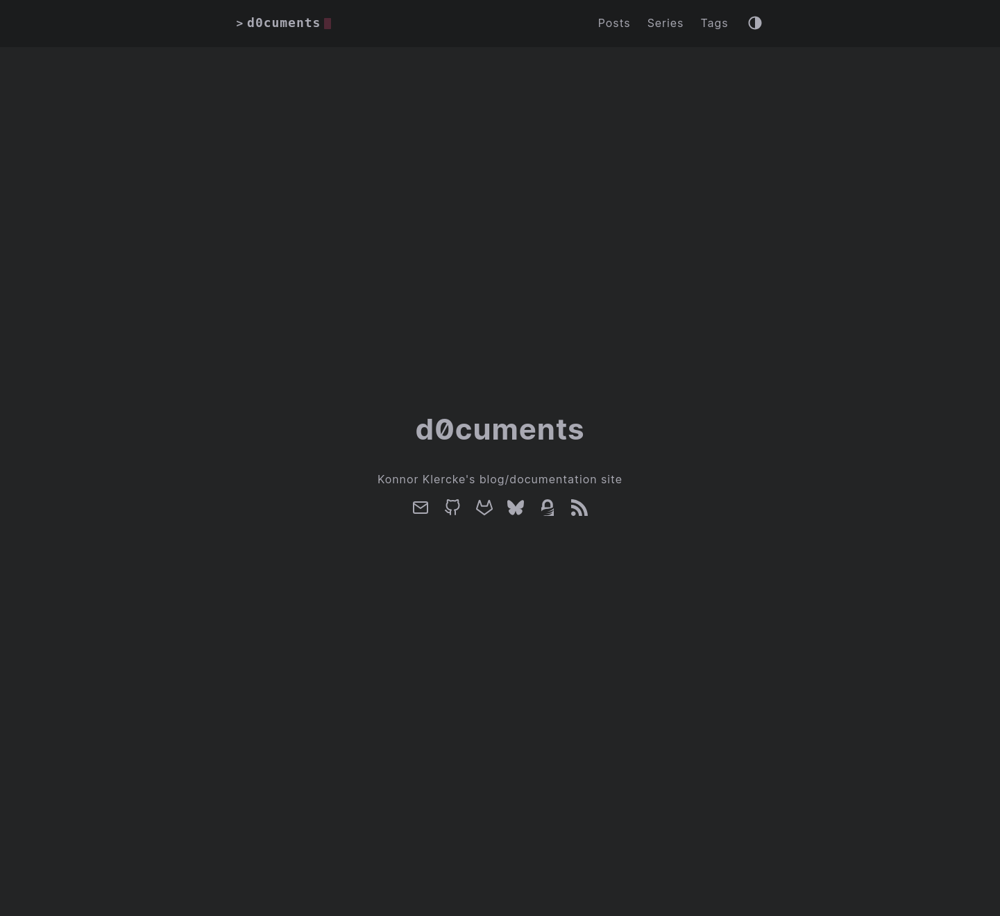

# d0cuments

[](https://github.com/klercke/d0cuments/actions/workflows/blog.yml)
[](https://blog.klercke.com)

Source for [blog.klercke.com](https://blog.klercke.com), my blog about homelabbing, Linux, infrastructure, privacy, and whatever else I'm tinkering with.
It's a static site built with [Hugo](https://gohugo.io/) and the [Hello Friend NG](https://github.com/rhazdon/hugo-theme-hello-friend-ng) theme.



## Layout


| Path | What it is |
|---|---|
| `content/posts/` | Posts, one page Markdown file per post (`YYYY-MM-DD-slug/index.md` plus its images) |
| `archetypes/` | Front matter template for `hugo new` |
| `layouts/` | Overrides on top of the theme (image rendering, analytics snippet) |
| `themes/hello-friend-ng/` | The theme (as a Git submodule) |
| `hugo.toml` | Site config: menus, social links, comments |


## Development

Everything comes from the Nix dev shell (`nix develop`, or direnv with `use flake`).
Clone with the theme submodule:

```sh
git clone --recurse-submodules https://github.com/klercke/d0cuments.git
```

| Command | What it does |
|---|---|
| `hugo serve -D` | Serve the site locally with live reload, drafts included |
| `hugo new content posts/YYYY-MM-DD-slug/index.md` | Start a new post from the archetype (as a draft) |
| `hugo` | Build the site into `public/` |


Posts start as drafts.
Set `draft = false` (or delete the line) to publish.

## Deployment

Every push to `main` (or a manual run) builds the site and rsyncs `public/` to the web server.
The deploy key is restricted on the server to a write-only rsync into the blog's directory.
The `production` environment needs these secrets:


| Secret | Description |
|---|---|
| `DEPLOY_HOST` | Server hostname |
| `DEPLOY_PORT` | Admin SSH port |
| `DEPLOY_KNOWN_HOSTS` | Server host key, for `known_hosts` |
| `DEPLOY_SSH_KEY` | Blog deploy key |


The server side (Caddy, the deploy user, DNS) lives in my [homelab-as-code repo](https://github.com/klercke/homelab-as-code).
The blog shares a server with [klercke.com](https://github.com/klercke/website).

## Analytics and comments

- **Analytics:** [Plausible](https://plausible.io/) loaded first-party.
    Caddy serves the script at `/js/script.js` and proxies `/api/event`, so nothing on the page talks to a third party directly.
    The snippet is skipped entirely when the browser sends [Global Privacy Control](https://globalprivacycontrol.org/).
    See [klercke.com/privacy](https://klercke.com/privacy/).
- **Comments:** [Utterances](https://utteranc.es/) backed by GitHub issues in this repo labelled `Comment`.

## Writing

Posts are written in Markdown, usually in Neovim, but anything with a keyboard works.
